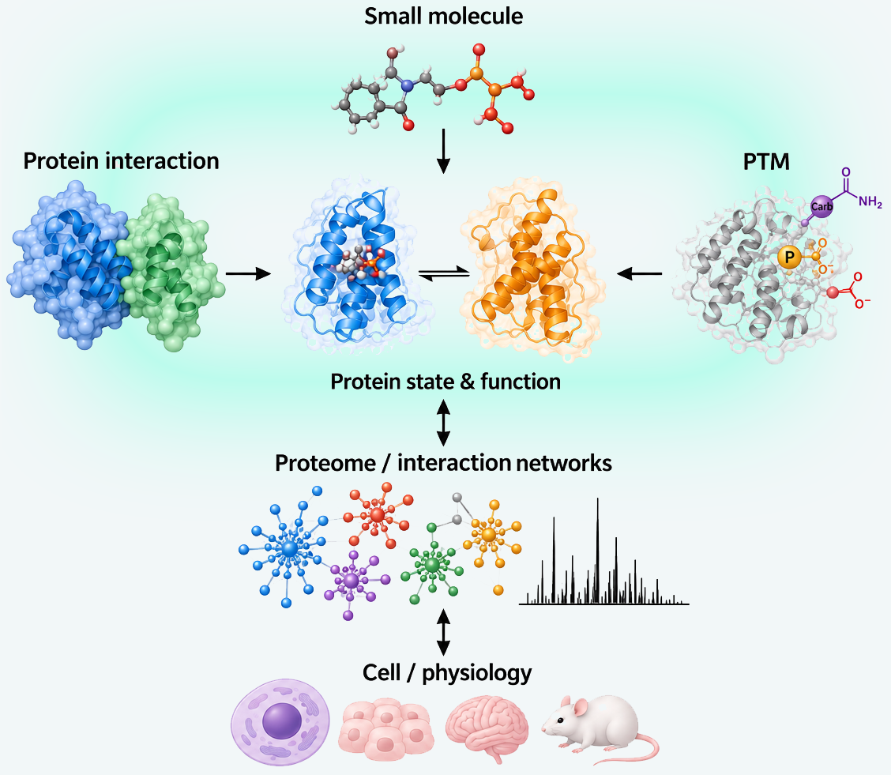

:::: {.hero}

::: {.hero-grid}

::: {.hero-copy}
## How molecular interactions reshape dynamic protein states to control function

I investigate how ligand binding, protein–protein interactions, membrane interactions, and post-translational modifications alter protein structure, assembly, and regulatory behavior. My research integrates structural biology, protein biochemistry, proteomics, and computational analysis across molecular and cellular systems.

[Explore research](research.qmd){.btn .btn-primary} [View publications](publications.qmd){.btn .btn-outline-primary}

Contact: [youngki.you.research@gmail.com](mailto:youngki.you.research@gmail.com)
:::

::: {.hero-image}

:::

:::

::::

## Selected research

::: {.grid}
::: {.g-col-12 .g-col-md-4}
### Molecular recognition and structural regulation

**Munc13-1 C1 domain** — defining how ligand recognition, binding-site architecture, and membrane interactions regulate the structural and cellular behavior of a neuronal signaling protein.

[Explore the project →](research.qmd#munc13-1)
:::

::: {.g-col-12 .g-col-md-4}
### Protein interaction architecture

**Cross-linking mass spectrometry** — mapping molecular contacts from defined protein assemblies to proteome-scale interaction networks and integrating experimental restraints with structural models.

[Explore the project →](research.qmd#xl-ms)
:::

::: {.g-col-12 .g-col-md-4}
### Post-translational regulation

**PTM proteomics** — investigating how protein modifications and PTM crosstalk alter molecular function, signaling pathways, and cellular responses.

[Explore the project →](research.qmd#ptm-biology)
:::
:::

## Research perspective

Proteins do not function as static structures. Their activities emerge from changes in conformation, molecular interactions, membrane environments, and chemical modification. My research seeks to understand how these dynamic molecular states are established and remodeled, and how these changes propagate from molecular interactions to cellular regulation.

<!-- Add three approved research images with accurate, accessible captions. -->