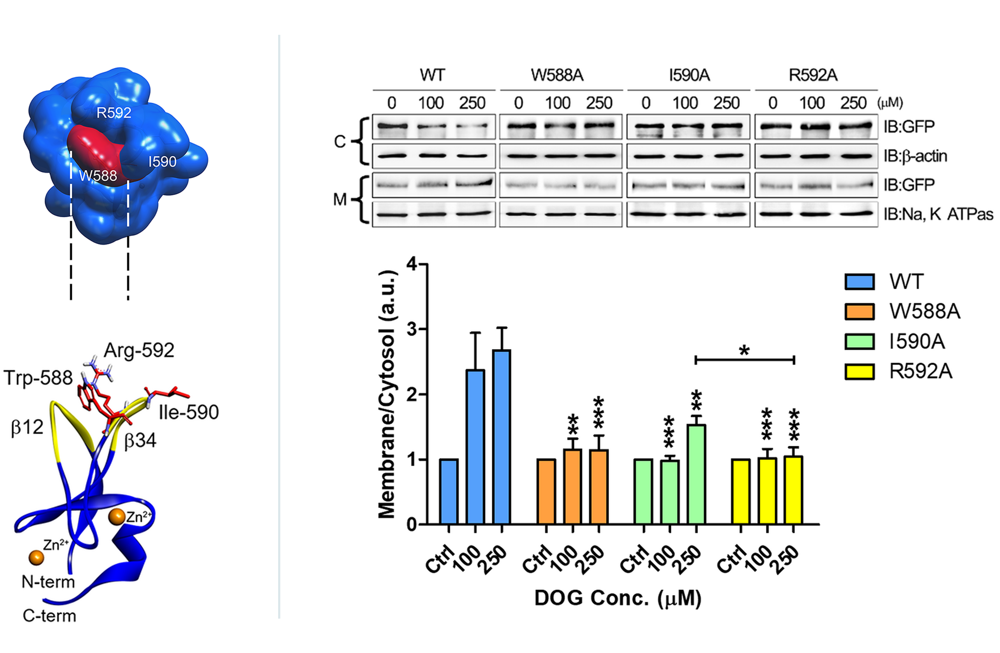
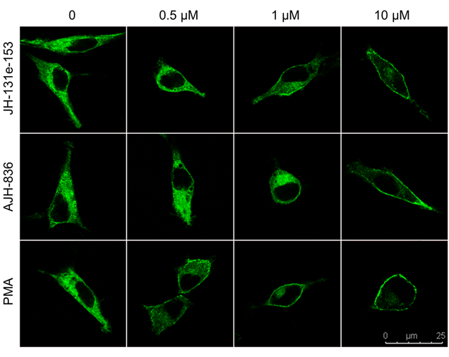
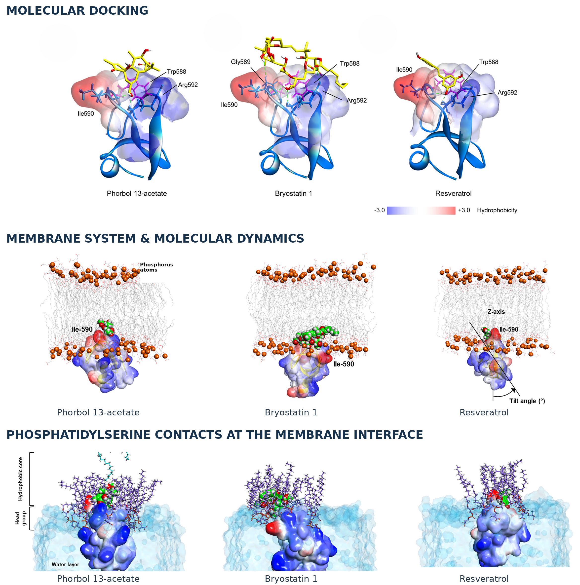
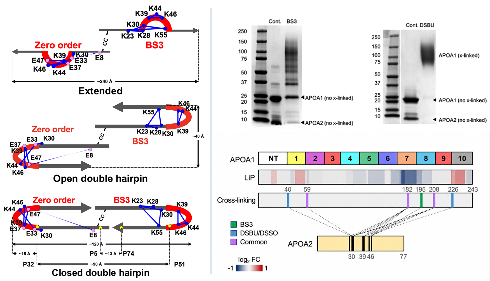
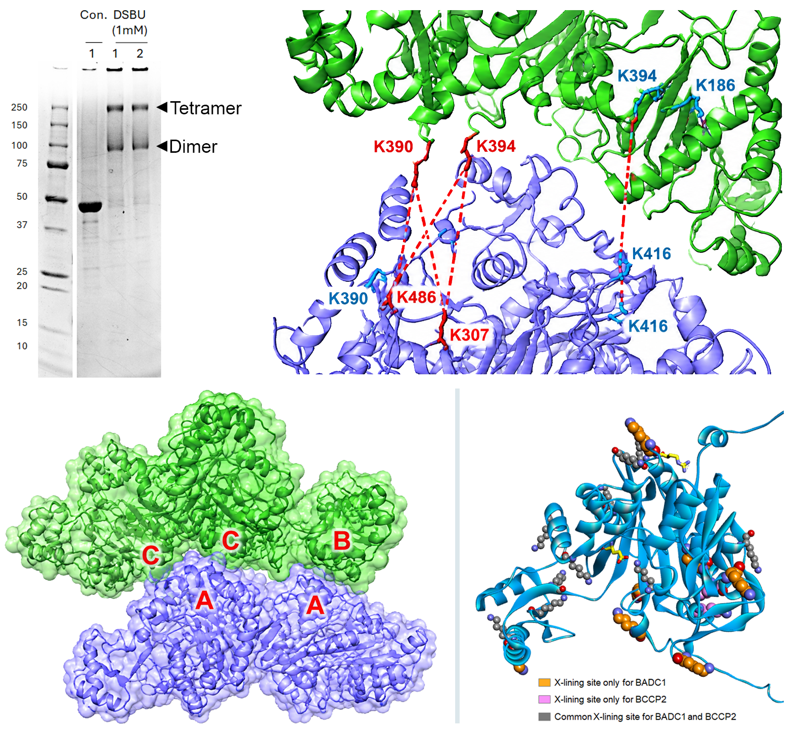
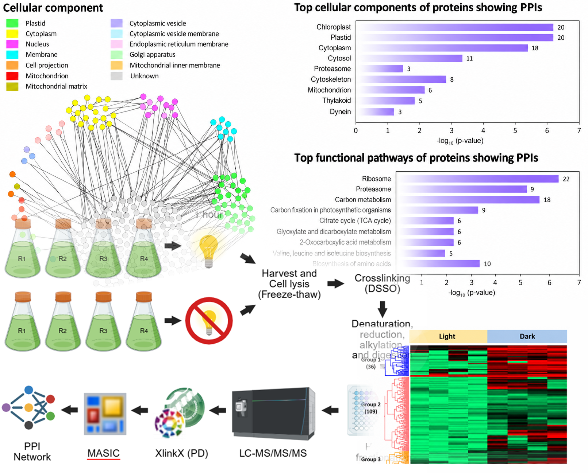
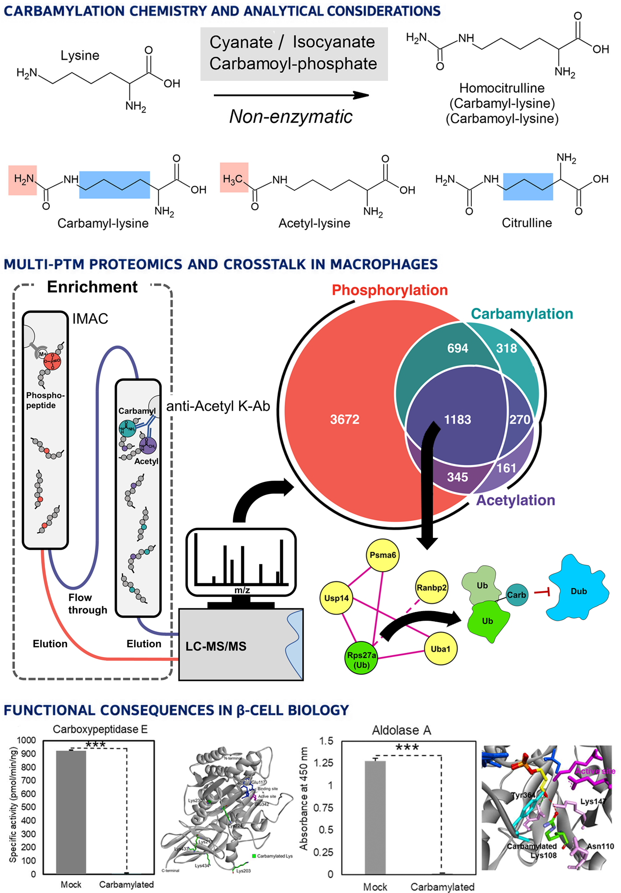
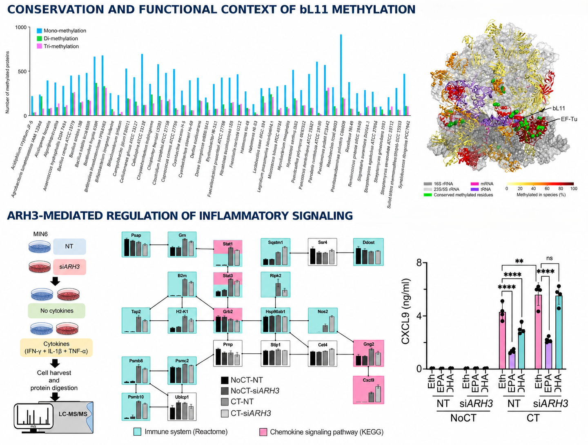

<!-- Munc13-1 case study synchronized 2026-09-22. -->

My research asks how molecular recognition, protein interactions, and chemical modifications of proteins affect their structure and function. I use the methods best suited to each biological question, combining structural and functional characterization of proteins with interaction mapping, proteomics, and computational analysis.

## Munc13-1 structural regulation {#munc13-1}

::: {.research-case-intro}
### From ligand recognition to membrane recruitment

Munc13-1 is an essential presynaptic active-zone protein that helps prime synaptic vesicles for neurotransmitter release. Its C1 domain recognizes lipid-embedded signals and pharmacological ligands at the plasma membrane. I examined how binding-site residues, ligand chemistry, and membrane composition control Munc13-1 activation—from atomistic models to full-length protein behavior in neuronal cells.

::: {.research-facts}
::: {.research-fact}
**Research question**

Which structural features of the C1 domain determine ligand-dependent activation of Munc13-1?
:::
::: {.research-fact}
**Integrated approach**

Mutagenesis, cell biology, protein biochemistry, NMR, confocal microscopy, molecular docking, and membrane molecular dynamics.
:::
::: {.research-fact}
**Research scope**

Endogenous DAG, phorbol esters, DAG-lactones, bryostatin 1, resveratrol, and ethanol modulation.
:::
:::
:::

::: {.panel-tabset .research-tabs}
## 1 · Residues and mutations

01
<h3>Defining the ligand-responsive C1 pocket</h3>

I used the NMR structure and binding-pocket geometry to identify Trp-588, Ile-590, and Arg-592 as candidate residues for mutagenesis. NMR titration was used to examine how the W588A, I590A, and R592A substitutions affected ligand binding, while cell fractionation and immunoblotting tested whether these mutations altered DOG- and phorbol ester-induced recruitment of full-length Munc13-1 to the membrane.

<figure class="research-slide-figure">

<figcaption>Binding-pocket rationale (left) and cell-fractionation/Western-blot validation of DOG-induced membrane recruitment (right).</figcaption>
<a class="figure-link" href="images/munc13/munc13-structural-determinants-v2.png" target="_blank">Open full-resolution figure ↗</a>
</figure>

<strong>Key finding:</strong> Trp-588, Ile-590, and Arg-592 contributed differently to C1-domain function. Trp-588 was most critical for DOG binding, whereas all three residues supported ligand-induced membrane recruitment, with Arg-592 showing a particularly strong contribution in the full-length protein.

## 2 · Ligand-dependent modulation

02
<h3>Comparing ligand-dependent effects in cells</h3>

I investigated how diverse ligands and chemical modulators alter Munc13-1 behavior in HT22 cells. Using full-length GFP-tagged Munc13-1, I examined ligand-dependent changes in membrane recruitment and intracellular localization across multiple compounds, including DAG, DAG-lactones, phorbol esters, bryostatin, and resveratrol. These studies enabled comparison of how structurally distinct compounds differentially modulate Munc13-1 localization and activity in cells.

<figure class="research-slide-figure">

<figcaption>Representative confocal images of Munc13-1 redistribution after treatment with JH-131e-153, AJH-836, or PMA.</figcaption>
<a class="figure-link" href="images/munc13/munc13-dag-lactone-confocal-v2.png" target="_blank">Open full-resolution figure ↗</a>
</figure>

<strong>Key finding:</strong> both DAG-lactones recruited Munc13-1 to the membrane, but JH-131e-153 produced a stronger response than AJH-836 across the tested concentrations; PMA produced the strongest recruitment under the assay conditions.

## 3 · Membrane mechanisms

03
<h3>Resolving ligand–protein–membrane mechanisms</h3>

I built lipid membrane systems and used molecular docking and dynamics to compare phorbol 13-acetate, bryostatin 1, resveratrol, and DAG-lactones. Additional studies examined ethanol modulation and compared Munc13-1 with other C1 domains.

<figure class="research-slide-figure">

<figcaption>Docking poses (top), representative membrane-MD configurations (middle), and phosphatidylserine contacts at the membrane interface (bottom) for three chemically distinct ligands.</figcaption>
<a class="figure-link" href="images/munc13/munc13-docking-md-v2.png" target="_blank">Open full-resolution figure ↗</a>
</figure>

<strong>Key finding:</strong> activators and inhibitors produce distinct pocket interactions, conformational stability, membrane positioning, and lipid contacts; ethanol further alters this balance through a Glu-582-centered mechanism influenced by phosphatidylserine.

:::

::: {.research-takeaway}
**Scientific contribution.** This research program established a mechanistic framework for Munc13-1 C1-domain regulation: binding-site residues encode ligand selectivity, the membrane is an active component of recognition, and molecular changes at the pocket propagate to full-length protein recruitment in cells.
:::

Research map: Munc13-1 publications and my contributions

| Theme | Publication and contribution | Main advance |
|---|---|---|
| **Ligand inhibition** | [Resveratrol inhibits phorbol ester-induced membrane translocation of presynaptic Munc13-1](https://doi.org/10.1016/j.bbagen.2017.07.006) (2017). Molecular docking and MD. | Established Munc13-1 as a resveratrol target and modeled competition at the C1-domain pocket. |
| **Binding-site mutations** | [Critical role of Trp-588 of presynaptic Munc13-1](https://doi.org/10.1021/acs.biochem.7b00764) (2017). MD simulation and analysis. | Identified Trp-588 as a determinant of ligand binding and membrane translocation. |
| **Ligand activation** | [Munc13 is a molecular target of bryostatin 1](https://doi.org/10.1021/acs.biochem.9b00427) (2019). Molecular docking. | Established Munc13 proteins as high-affinity bryostatin 1 targets. |
| **Allosteric modulation** | [Effect of ethanol on Munc13-1 C1 in membrane](https://doi.org/10.1111/acer.14363) (2020; first author). Docking, membrane-system construction, MD, and analysis. | Defined a Glu-582-centered, membrane-composition-dependent mechanism for ethanol modulation. |
| **DAG recognition** | [Probing the diacylglycerol binding site of presynaptic Munc13-1](https://doi.org/10.1021/acs.biochem.1c00165) (2021; first author). Cell assays, docking, membrane systems, and MD. | Identified Trp-588, Ile-590, and Arg-592 as ligand-dependent determinants of activation. |
| **Activator versus inhibitor** | [Molecular dynamics simulation studies on binding of activator and inhibitor](https://doi.org/10.1080/07391102.2021.2001375) (2022; first author). Docking, membrane systems, MD, and analysis. | Explained ligand-specific conformational stability, membrane positioning, and lipid interactions. |
| **C1-domain comparison** | [Comparison of the ligand binding site of C1 domains](https://doi.org/10.1080/07391102.2022.2163699) (2023; first author). Docking, membrane systems, MD, and analysis. | Classified C1-domain pocket types and identified conserved determinants of ligand–membrane binding. |
| **Selective activation** | [Activation of Munc13-1 by DAG-lactones](https://doi.org/10.1021/acs.biochem.3c00375) (2023; co-first author). Cell culture, mutagenesis, translocation assays, and docking. | Demonstrated stereochemistry-dependent activation and linked ligand selectivity to Trp-588, Ile-590, and Arg-592. |

## XL-MS and protein–protein interaction architecture {#xl-ms}

::: {.research-case-intro}
### Mapping molecular contacts from defined assemblies to proteome-scale interaction networks

Protein–protein interactions organize cellular pathways and macromolecular assemblies, yet many are transient, heterogeneous, or difficult to resolve using a single structural method. Cross-linking mass spectrometry (XL-MS) captures spatial proximity by covalently linking nearby amino-acid residues and identifying the resulting cross-linked peptides by LC–MS/MS. I applied XL-MS across human plasma lipoproteins, plant enzyme complexes, and photosynthetic microorganisms to investigate protein interactions across multiple structural scales—from residue-level binding interfaces and defined protein assemblies to proteome-scale interaction networks. By integrating XL-MS restraints with biochemical assays, molecular docking, structure prediction, and cryo-EM, I used these approaches to characterize apolipoprotein interactions, define the organization of the heteromeric acetyl-CoA carboxylase complex, and develop workflows for large-scale mapping of condition-dependent protein interactions in photosynthetic microorganisms.

::: {.research-facts}
::: {.research-fact}
**Research question**

How can experimentally measured residue proximities reveal where proteins interact and how those contacts organize cellular networks and higher-order assemblies?
:::

::: {.research-fact}
**Integrated approach**

Protein expression and purification, chemical cross-linking, peptide fractionation, LC–MS/MS, cross-link identification and validation, biochemical assays, molecular docking, structure prediction, and cryo-EM.
:::

::: {.research-fact}
**Research scope**

Photosynthetic microorganisms (*Chlamydomonas reinhardtii* and *Prochlorococcus* MED4), human HDL apolipoproteins (APOA1 and APOA2), and the plant heteromeric acetyl-CoA carboxylase complex.
:::
:::
:::

::: {.panel-tabset .research-tabs}
## 1 · Apolipoprotein interactions

02
<h3>Defining apolipoprotein interactions and HDL remodeling</h3>

I used isotope-coded and MS-cleavable cross-linkers to map residue-level contacts between APOA1 and APOA2 in native and reconstituted HDL. These XL-MS restraints were integrated with limited proteolysis, quantitative proteomics, engineered APOA1 variants, cholesterol-efflux measurements, and structural modeling to determine how APOA2 associates with HDL and alters the conformation and function of resident APOA1.

<figure class="research-slide-figure">

<figcaption>XL-MS-constrained APOA2 structural models (left), cross-linking validation of APOA1/APOA2 assemblies (top right), and residue-level mapping of APOA1–APOA2 contacts on HDL (bottom right).</figcaption>
<a class="figure-link" href="images/xlms/apoa2-remodeling.png" target="_blank">Open full-resolution figure ↗</a>
</figure>

<strong>Key finding:</strong> XL-MS constrained candidate APOA2 architectures, while integration with disulfide geometry and structural modeling supported a closed, antiparallel double-hairpin organization on HDL. Complementary structural and functional measurements showed that APOA2 remodels mature HDL, increases exposure of the APOA1 C-terminal region, and enhances ABCA1-mediated cholesterol efflux.

## 2 · Heteromeric ACCase assembly

02
<h3>Defining BC-centered interactions and oligomerization</h3>

I applied XL-MS to investigate interaction architecture among components of the plant heteromeric acetyl-CoA carboxylase system, including biotin carboxylase (BC), BADC1, and BCCP2. I designed cross-linking experiments, analyzed reproducible intra- and interprotein residue pairs using complementary search workflows, and mapped the resulting restraints onto predicted and experimentally determined structures. In the published BC study, I integrated XL-MS with cryo-EM and structural modeling to evaluate monomeric, dimeric, and higher-order assemblies; related interaction studies extended this strategy to additional heteromeric ACCase components.

<figure class="research-slide-figure">

<figcaption>DSBU cross-linking of BC oligomers (top left), XL-MS-guided modeling of the BC dimer-of-dimers interface (top right), the resulting higher-order BC assembly (bottom left), and additional XL-MS mapping of BC interactions with BADC1 and BCCP2 (bottom right).</figcaption>

<a class="figure-link" href="images/xlms/biotin-carboxylase-assembly.png" target="_blank">Open full-resolution figure ↗</a>
</figure>

<strong>Key finding:</strong> XL-MS distinguished contacts compatible with lower-order BC structures from those requiring a higher-order arrangement, supporting an asymmetric, staggered dimer of dimers. The broader project established a residue-level framework for evaluating candidate interfaces among BC, BADC1, and BCCP2 within the heteromeric ACCase system.

## 3 · Proteome-scale XL-MS

03
<h3>From XL-MS workflow development to condition-dependent PPI mapping</h3>

I developed and optimized an end-to-end XL-MS workflow for complex biological samples by evaluating cell disruption, cross-linking chemistry, peptide enrichment and fractionation, LC–MS/MS acquisition parameters, and computational identification strategies. I applied the workflow to *Chlamydomonas reinhardtii* and *Prochlorococcus* MED4 to generate residue-level interaction datasets, map protein–protein interaction networks, and compare condition-dependent interaction patterns.

<figure class="research-slide-figure">

<figcaption>Proteome-scale XL-MS applications across photosynthetic microorganisms. Cellular-component and pathway analysis of a *Chlamydomonas reinhardtii* PPI network (top), the developed XL-MS workflow (middle), and condition-dependent alterations in protein–protein interactions in *Prochlorococcus* MED4 obtained using the workflow (bottom right). Only aggregate and schematic representations are shown for unpublished datasets.</figcaption>

<a class="figure-link" href="images/xlms/xlms-workflow.png" target="_blank">Open full-resolution figure ↗</a>
</figure>

<strong>Key finding:</strong> Freeze–thaw lysis improved unique cross-linked peptide-pair recovery, and peptide fractionation further increased cross-link identifications in *Chlamydomonas reinhardtii*. Application of the optimized workflow to *Prochlorococcus* MED4 generated approximately 2,700 interprotein cross-links and identified significant differences in cross-linking patterns between light and dark growth conditions.

:::

::: {.research-takeaway}
**Scientific contribution.** I developed and applied XL-MS across multiple biological scales, from residue-level protein interfaces and defined assemblies to proteome-scale PPI networks. I used cross-links as experimental evidence of molecular proximity to support structural interpretation and interaction mapping.
:::

Research map: XL-MS publication and contributions

| Theme | Publication and contribution | Main advance |
|---|---|---|
| **HDL remodeling** | [APOA2 increases cholesterol efflux capacity to plasma HDL by displacing the C-terminus of resident APOA1](https://doi.org/10.1016/j.jlr.2024.100686) (2024). XL-MS and data analysis. | Mapped APOA1–APOA2 interactions and identified APOA2-induced conformational changes in APOA1 associated with HDL remodeling. |
| **XL-MS in disease research** | [Exploring new frontiers in type 1 diabetes through advanced mass-spectrometry-based molecular measurements](https://doi.org/10.1016/j.molmed.2024.07.009) (2024; review). Reviewed and synthesized literature on XL-MS applications in type 1 diabetes. | Positioned XL-MS among emerging mass-spectrometry approaches for investigating protein interactions and disease mechanisms in type 1 diabetes. |
| **APOA2 architecture** | [A model of human APOA2 on HDL](https://doi.org/10.1016/j.jlr.2026.101113) (2026). XL-MS analysis, cross-linked peptide identification, and structural interpretation. | Provided residue-level restraints supporting the closed double-hairpin model of APOA2 and its interactions with APOA1 on HDL. |
| **BC oligomerization** | [Oligomeric assemblies of plant biotin carboxylase revealed by cryo-EM and cross-linking](https://doi.org/10.1042/BCJ20250372) (2026). XL-MS and data analysis; cross-links supported structural modeling of higher-order BC assemblies. | Identified inter-dimer restraints supporting an asymmetric, staggered dimer-of-dimers model integrated with cryo-EM. |

## PTM biology and disease mechanisms {#ptm-biology}

::: {.research-case-intro}
### Linking protein modifications to molecular and cellular function

Post-translational modifications can alter protein structure, activity, molecular interactions, and cellular signaling. My PTM research focuses on how chemical modifications of proteins affect molecular function and disease-associated pathways. I combine proteomics, PTM enrichment, functional analysis, and structural interpretation to move from large-scale modification maps toward specific biological consequences.

::: {.research-facts}
::: {.research-fact}
**Research question**

How do specific protein modifications alter protein function, regulatory pathways, and cellular responses?
:::

::: {.research-fact}
**Integrated approach**

PTM enrichment, LC–MS/MS, proteomics data analysis, functional enrichment, motif analysis, structural analysis, and cell-based validation.
:::

::: {.research-fact}
**Research scope**

Carbamylation, acetylation, phosphorylation, methylation, ADP-ribosylation, PTM crosstalk, and inflammatory and metabolic regulation.
:::
:::
:::

::: {.panel-tabset .research-tabs}
## 1 · Carbamylation and PTM crosstalk

01
<h3>carbamylome mapping to molecular function and disease biology</h3>

I developed proteomics strategies to investigate lysine carbamylation as a functional PTM rather than a sample-preparation artifact. In macrophages, I integrated carbamylation, acetylation, and phosphorylation to examine PTM crosstalk during inflammatory signaling, linking carbamylation to ubiquitin regulation and inhibition of OTULIN. I also examined smoking-associated carbamylation in lung tissue across cigarette, e-cigarette, dual-use, and air-exposed conditions. More recently, I extended this work to pancreatic β cells, where inflammatory cytokines altered carbamylation of metabolic and insulin-processing proteins. Functional testing showed that carbamylation inhibits aldolase A and carboxypeptidase E.

<figure class="research-slide-figure">

<figcaption>Carbamylation chemistry and structural similarity to related lysine modifications (top), proteomic workflow development and PTM crosstalk analysis in macrophages (middle), and functional consequences of carbamylation on β-cell metabolic and insulin-processing enzymes (bottom).</figcaption>
<a class="figure-link" href="images/ptm/carbamylation-ptm-crosstalk.png" target="_blank">Open full-resolution figure ↗</a>
</figure>

<strong>Key finding:</strong> Carbamylation intersected with acetylation and phosphorylation during inflammatory signaling and produced functional effects on ubiquitin regulation and β-cell enzymes involved in metabolism and insulin processing.

## 2 · PTMs in cellular regulation

02
<h3>Connecting PTMs with signaling, stress responses, and disease-related pathways</h3>

I applied proteomics and functional analysis to investigate how different PTMs regulate cellular processes across biological systems. In bacteria, I analyzed conserved methylation sites and PrmA-dependent proteomic changes, helping define a role for ribosomal protein L11 methylation in stringent-response signaling and ribosome regulation. In pancreatic β-cell models, I combined cell-based experiments, LC–MS/MS, and pathway analysis to study ARH3-associated regulation under inflammatory conditions and its relationship to cytokine-induced CXCL9 expression.

<figure class="research-slide-figure">

<figcaption>Evolutionarily conserved bacterial protein methylation and structural localization of methylated sites on the ribosome (top), and ARH3-dependent regulation of inflammatory and chemokine signaling in MIN6 β cells, including CXCL9 responses to cytokines and omega-3 fatty acids (bottom).</figcaption>
<a class="figure-link" href="images/ptm/ptm-cellular-regulation.png" target="_blank">Open full-resolution figure ↗</a>
</figure>

<strong>Key finding:</strong> PTM-focused proteomics linked conserved bL11 methylation to bacterial stringent-response and ribosome regulation, while β-cell studies connected ARH3-dependent regulation with suppression of inflammatory CXCL9 expression by omega-3 fatty acids.

:::

::: {.research-takeaway}
**Scientific contribution.** I applied PTM-centered proteomics to connect modification patterns with molecular function and cellular regulation across diverse biological systems. By integrating PTM mapping with structural, pathway, and functional analyses, I investigated how carbamylation, methylation, and ADP-ribosylation contribute to inflammatory signaling, stress responses, metabolism, and disease-related pathways.
:::

Research map: PTM publications and contributions

| Theme | Publication and contribution | Main advance |
|---|---|---|
| **Carbamylation and PTM crosstalk** | [Analysis of a macrophage carbamylated proteome reveals a function in post-translational modification crosstalk](https://doi.org/10.1186/s12964-023-01257-3) (2023; co-first author). Carbamylome analysis, multi-PTM integration, motif and pathway analysis, and structural interpretation. | Developed a proteomic strategy for carbamylation analysis and revealed crosstalk with acetylation and phosphorylation, linking carbamylation to ubiquitin regulation and OTULIN activity. |
| **Bacterial protein methylation** | [Regulation of bacterial stringent response by an evolutionarily conserved ribosomal protein L11 methylation](https://doi.org/10.1128/mbio.01773-24) (2024). Methylation-focused proteomics, comparative analysis, sequence conservation, and functional enrichment. | Identified conserved bacterial methylation sites and linked bL11 tri-methylation to stringent-response signaling and ribosomal homeostasis. |
| **ADP-ribosylation and inflammation** | [Reduction of Chemokine CXCL9 Expression by Omega-3 Fatty Acids via ADP-Ribosylhydrolase ARH3 in MIN6 Insulin-Producing Cells](https://doi.org/10.1002/pmic.202400053) (2025; first author). Proteomics, pathway analysis, and cell-based functional studies. | Connected ARH3-dependent regulation with inflammatory signaling and omega-3-mediated suppression of CXCL9 in pancreatic β cells. |
| **Carbamylation biology** | [Protein carbamylation and proteomics: from artifacts to elucidation of biological functions](https://doi.org/10.3389/frans.2024.1512573) (2025; first author; perspective). Literature synthesis and analysis of methodological and biological aspects of carbamylation proteomics. | Integrated analytical challenges with emerging biological functions of carbamylation and highlighted strategies for systematic carbamylome analysis. |
| **β-cell carbamylation** | [Carbamylome analysis reveals regulatory roles for lysine carbamylation in β-cell glycolytic and insulin-processing enzymes](https://www.biorxiv.org/content/10.64898/2026.05.29.728846v1) (bioRxiv preprint; under journal revision). Carbamylome/acetylome analysis, pathway analysis, structural interpretation, and functional studies. | Linked inflammation-regulated carbamylation to β-cell metabolism and insulin processing, including functional effects on aldolase A and carboxypeptidase E. |

## Research scope {#research-scope}

My research experience spans several areas of protein science and proteomics. My primary work centers on structural regulation, protein interactions, and post-translational modifications, with additional contributions to related biological and analytical areas.

- **Structural biology and molecular recognition** — ligand recognition, membrane-associated protein regulation, and structure–function relationships
- **Structural proteomics and protein interactions** — XL-MS, protein–protein interaction mapping, macromolecular assemblies, and integrative structural analysis
- **Post-translational modification biology** — carbamylation, methylation, acetylation, phosphorylation, ADP-ribosylation, and PTM crosstalk
- **Lipoprotein and apolipoprotein biology** — HDL-associated protein interactions, APOA1/APOA2 organization, and lipoprotein remodeling
- **Type 1 diabetes and β-cell biology** — inflammatory signaling, proteomic responses, PTM regulation, and insulin-processing pathways
- **Extracellular-vesicle proteomics** — proteomic data integration, evidence synthesis, and analytical approaches for biomarker research
- **Protein binders and nanobody development** — involvement in protein-binder and nanobody-related research supporting molecular recognition and protein-interaction studies
- **Proteomics methods and resource development** — development and application of workflows for PTM analysis, XL-MS, comparative proteomics, and cross-species proteomic analysis

## Future research direction {#future-research-direction}

I am interested in developing integrative structural and proteomic approaches to investigate how dynamic protein conformations and interaction networks regulate cellular signaling. Building on my studies of Munc13-1 and other regulatory protein systems, I am particularly interested in membrane-associated and neuronal signaling proteins, while extending this framework to selected inflammation- and immune-related regulatory pathways.

**Long-term direction:** to define how structural remodeling of dynamic protein complexes propagates across interaction networks to regulate cellular function.

## Technical expertise {#technical-expertise}

My research integrates protein biochemistry, structural biology, mass spectrometry, cellular assays, and computational analysis to investigate protein structure, interactions, modifications, and function.

- **Protein expression, purification, and engineering** — bacterial and mammalian expression; unlabeled and isotopically labeled protein production; His/GST-tag purification; affinity and ion-exchange chromatography; SEC/ÄKTA; construct design, mutagenesis, buffer optimization, and protein stabilization

- **Structural biology and biophysical analysis** — X-ray crystallography, NMR sample preparation and NMR-guided structural interpretation, XL-MS, and integrative analysis of protein–protein and protein–ligand interactions

- **Mass spectrometry and proteomics** — LC–MS/MS, quantitative proteomics, XL-MS, TMT labeling, S-Trap processing, IMAC enrichment, antibody-based PTM enrichment, and analysis of carbamylation, acetylation, phosphorylation, and methylation

- **Protein interaction and binder analysis** — protein–protein interaction mapping, protein-complex characterization, nanobody-based binder development, ELISA-based binding assays, and antibody/nanobody specificity assessment

- **Computational structural biology** — structure prediction with AlphaFold, RoseTTAFold, and IgFold; molecular docking with AutoDock and MOE; molecular dynamics simulations with GROMACS; and structural visualization using PyMOL, Chimera, and Discovery Studio

- **Cellular and functional studies** — mammalian and bacterial cell culture, transformation, transfection, immunoprecipitation, Western blotting, confocal microscopy, and functional assays linking molecular changes with protein localization and activity

- **Data analysis and integration** — FragPipe/MSFragger, MaxQuant, Perseus, XlinkX, pLink, Python, R, Linux-based workflows, functional enrichment, sequence analysis, and integration of proteomic, structural, and biochemical data
